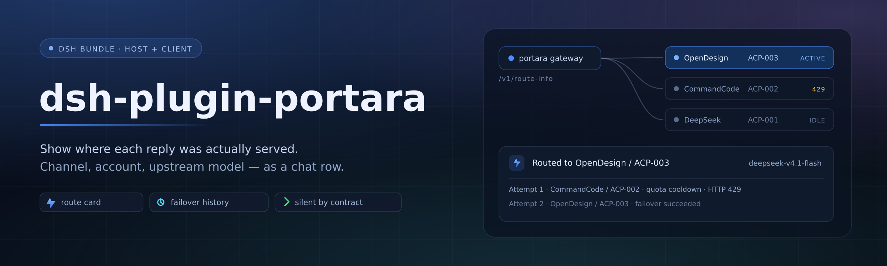

<div align="center">



<h1>dsh-plugin-portara</h1>

<p><strong>See the gateway route behind every reply — channel, account, upstream model, failover history — as a collapsible row in the DeepSeek Harness chat stream.</strong></p>

[![DeepSeek Harness][dsh-badge]][dsh]
[![Node.js][node-badge]][node]
[![Platform][platform-badge]][dsh]
[![Tests][tests-badge]](#how-to-contribute)
[![License][license-badge]][license]
[![Last commit][commit-badge]][commits]
[![Stars][stars-badge]][stargazers]

</div>

---

## Introduction

When a model route is a [Portara](#about-portara) gateway, the reply you read was chosen by a load
balancer: a channel, an upstream account, maybe a retry after someone else's quota ran out. Normally that
context is invisible from inside the conversation. This bundle puts it where the answer is.

```text
⚡ Switched to OpenDesign / ACP-003 (attempt 2) · deepseek-v4.1-flash   ▸
```

One row per gateway session, at the same level as a tool-call card. No failover means a one-line summary; a
failover expands into the attempts that produced the answer. The routed model is also appended to the end
of each turn's status row, so the last line of every reply carries `⚡ <upstream model>` without opening
anything. And `/portara route` prints the same facts once, on demand, without spending a model call.

```text
Attempt 1 · CommandCode / ACP-002 · quota cooldown · HTTP 429 · 00:22:31
Attempt 2 · OpenDesign / ACP-003 · failover succeeded · 00:22:39
```

### How it works

The bundle has two halves that share one package and one profile row — no kernel file is modified.

| Half | Seam | What it does |
| --- | --- | --- |
| Host | `llm-pi-ai/request-headers` | stamps the harness session id as `x-portara-client-session`, so the gateway partitions the request and the later query under the same session key |
| Host | `llm/stream` | after each conversation call (successful or failed) queries `GET <baseURL>/route-info`, optionally polling while the call is still streaming |
| Host | `appendPluginRecord()` | writes a `plugin:portara/route` record — an ignorable, log-only event that older readers retain and skip |
| Client | `uiConversation.events.register()` | one Chat row per gateway session key; later records update that row instead of stacking |
| Client | `conversation.chat.node` slot | the collapsible row, localized in English and Chinese, styled with host theme tokens |
| Client | `conversation.chat.assistant-actions` slot | appends the routed model to the turn status row via one flex item ordered after the host-owned clock |
| Host | `/portara` command | `route` prints the session's current route and refreshes the card; the handler answers the UI directly, so no model call is spent |

### Behaviour guarantees

- **Silent by contract** — unreachable gateway, timeout, non-200, oversized body, malformed JSON, or a
  missing session all resolve to "write nothing". Nothing surfaces in the chat, and no model call fails or
  slows because of this plugin.
- **Reload-safe records** — `Session.append()` cannot mark an event ignorable, and an unknown
  non-ignorable event makes the session unreadable on the next load. The plugin writes only `plugin:`
  records through `appendPluginRecord()` and resolves the Host's own Session module instance first, because
  a second copy of that module cannot brand the Host's `Session`.
- **No duplicate cards** — records are deduped by the observed routing facts, and every record of one
  gateway session key updates the same row.
- **No secrets** — the API key stays in the Host process; records carry only the routing facts the gateway
  chose to expose, and nothing is logged.

The reasoning behind these choices, including the rejected alternatives, is in
[docs/DESIGN.md](docs/DESIGN.md).

## How to Install

Requires DeepSeek Harness `0.2.x` with the `llm-pi-ai` adapter and a gateway that can answer
`/v1/route-info`.

```bash
git clone https://github.com/Dynesshely/dsh-plugin-portara.git
dsh plugin install ./dsh-plugin-portara
```

Or from the Web UI: **Plugin manager → install a local bundle**. A new bundle can activate through the
loader's hot reload; the browser half loads on the next page load. No `dsh` restart is required.

### Gateway prerequisite

The gateway hides upstream topology by default. Turn disclosure on where you accept that exposure:

```text
exposeRoutingInfo: true
exposeRoutingDetail: channel   # off | alias | channel
```

With disclosure off, the endpoint answers with an empty structure and this plugin writes nothing — no card,
no error, and no polling while a reply streams.

### Configuration

Every key is optional; the defaults work as-is.

```yaml
- insert:
    - id: portara-route
      name: dsh-plugin-portara
      config:
        enabled: true             # false disables observation entirely
        timeoutMs: 1500           # route-info budget, clamped to 100…10000
        pollIntervalMs: 2000      # in-flight failover polling; 0 disables
        injectSessionHeader: true # only confirmed gateway endpoints receive the session header
        gateways:                 # optional explicit gateways (skips discovery)
          - baseURL: https://portara.example/v1
            apiKeyEnv: GATEWAY_API_KEY
```

Gateway discovery reads the live model-provider configuration: every provider that declares a `baseURL` and
an `apiKeyEnv` is probed once, and an endpoint that answers as a `route.info` data plane is treated as a
gateway. Credentials resolve through the Host credential service, falling back to the process environment.

### Verify it yourself

1. Send one message over the gateway route.
2. A `⚡ Routed to …` row appears next to the reply; with a failover it is collapsible.
3. The end of the turn status row shows `⚡ <upstream model>`.
4. Run `/portara route` — the command prints channel, account, upstream model, and the failover history.
5. The session log holds a `plugin:portara/route` event with `ignorable: true`.
6. Turn disclosure off and send again: no record, no error, and the command explains why.

## How to Contribute

Issues and pull requests are welcome — [open an issue][issues] first for anything larger than a typo, so the
approach can be agreed before code.

```bash
git clone https://github.com/Dynesshely/dsh-plugin-portara.git
cd dsh-plugin-portara

npm test      # node:test — payload, gateway client, provider discovery, client rendering, Host integration
npm run check # node --check on every shipped source file
```

- **No build step, no runtime dependencies.** The host half is plain ESM; the browser half is a
  `window.__ModuleLoader__.load()` bundle that takes React from the page's module table.
- **Tests are the contract.** The Host integration test creates a real (independent) `Session`, a local
  HTTP gateway, and a temporary profile whose `node_modules` links the installed
  `@deepseek-ai/dsh-session`, so the record path is exercised without a running Harness. It skips itself
  when that package is unavailable.
- **Commits** follow Conventional Commits and are GPG-signed in this repository; keep the subject in the
  imperative mood.
- **Do not break sessions.** Any change that writes session events must keep unknown-event reload safety in
  mind; see [docs/DESIGN.md](docs/DESIGN.md).
- **Do not leak topology.** Channel and account names are upstream infrastructure. Fixtures must use
  invented values, and no real API keys, host names, or private endpoints belong in a commit.

## About Portara

[![Portara][portara-badge]][portara]

Portara is an aggregated, enterprise-grade AI API gateway: one endpoint in front of many providers and
accounts, with routing, quota, billing, and audit behind it. This plugin consumes its **routing disclosure**
data-plane API.

Two channels carry the facts:

| Channel | Where | Use |
| --- | --- | --- |
| Response headers | every `/v1/*` response | the route of one request, at zero extra cost |
| Query endpoint | `GET /v1/route-info` | the session's current route plus its failover history |

Session keys are resolved in this order — the same value must be used by the request and the query:

1. `x-portara-client-session`
2. `x-deepseek-harness-session-id`
3. the request body's `prompt_cache_key`
4. a context fingerprint, only when the gateway enables it

```json
{
  "object": "route.info",
  "sessionKey": "8ff4d582",
  "updatedAt": "2026-11-11T16:22:39.250Z",
  "route": {
    "alias": "balance/deepseek-flash",
    "channel": "OpenDesign",
    "account": "ACP-003",
    "upstreamModel": "deepseek-v4.1-flash"
  },
  "history": [
    {
      "attempt": 1,
      "channel": "CommandCode",
      "account": "ACP-002",
      "outcome": "quota_cooldown",
      "statusCode": 429,
      "reason": "…",
      "at": "2026-11-11T16:22:31.000Z"
    }
  ]
}
```

The plugin never talks to Portara's management API, never stores route history, and never sends the API key
outside the Host process.

## Structure

```text
dsh-plugin-portara/
├── index.js                 # Host entry: apply, inject, name
├── client.js                # browser half: Conversation Definition, Chat row, locale copy
├── cordis.patch.yml         # the bundle's one profile row
├── package.json             # dsh.bundle + dsh.client manifest
├── icon.svg                 # Plugin Manager artwork
├── locale/
│   ├── en.json              # plugin-manager title and description
│   └── zh.json
├── src/
│   ├── payload.js           # durable payload normalization and dedupe signature
│   └── host/
│       ├── index.js         # listener wiring, polling, dedupe, /portara registration
│       ├── command.js       # /portara verb grammar and plain-text route formatting
│       ├── gateway.js       # timeout-bounded, silent /route-info client
│       ├── provider.js      # provider discovery, credential resolution, header decision
│       └── records.js       # Host Session module resolution and plugin-record append
├── test/
│   ├── payload.test.js
│   ├── gateway.test.js
│   ├── provider.test.js
│   ├── client.test.js
│   ├── host.test.js         # real Session + local HTTP gateway
│   └── manifest.test.js     # package, patch, locale, icon, README checks
├── docs/
│   └── DESIGN.md
└── assets/
    ├── banner.svg           # source of the banner
    └── banner.png           # rendered banner used above
```

## Star History

<picture>
  <source media="(prefers-color-scheme: dark)" srcset="https://api.star-history.com/svg?repos=Dynesshely/dsh-plugin-portara&type=Date&theme=dark" />
  <source media="(prefers-color-scheme: light)" srcset="https://api.star-history.com/svg?repos=Dynesshely/dsh-plugin-portara&type=Date&theme=light" />
  
</picture>

## License

[MIT](LICENSE) © 2026 Dynesshely

<!-- links -->
[dsh-badge]: https://img.shields.io/badge/dsh-0.2.2--alpha.2-6f42c1?style=flat-square
[node-badge]: https://img.shields.io/badge/node-%3E%3D20-339933?style=flat-square&logo=node.js&logoColor=white
[platform-badge]: https://img.shields.io/badge/platform-web-2ea44f?style=flat-square
[tests-badge]: https://img.shields.io/badge/tests-55%20passing-brightgreen?style=flat-square
[license-badge]: https://img.shields.io/github/license/Dynesshely/dsh-plugin-portara?style=flat-square
[commit-badge]: https://img.shields.io/github/last-commit/Dynesshely/dsh-plugin-portara?style=flat-square
[stars-badge]: https://img.shields.io/github/stars/Dynesshely/dsh-plugin-portara?style=flat-square
[portara-badge]: https://img.shields.io/badge/gateway-Portara-Crequency?style=flat-square

[dsh]: https://github.com/deepseek-ai/deepseek-harness
[node]: https://nodejs.org
[issues]: https://github.com/Dynesshely/dsh-plugin-portara/issues
[commits]: https://github.com/Dynesshely/dsh-plugin-portara/commits/main
[stargazers]: https://github.com/Dynesshely/dsh-plugin-portara/stargazers
[license]: LICENSE
[portara]: https://github.com/Crequency/Portara
